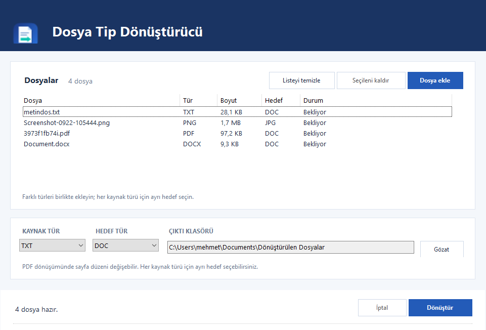

# Dosya Tip Dönüştürücü

Windows'ta belge, tablo, sunum, PDF ve görsel dosyalarını farklı türlere dönüştürmek için ücretsiz, açık kaynaklı bir masaüstü uygulaması. Dosyalarınız bilgisayarınızda işlenir; herhangi bir sunucuya yüklenmez.

## Uygulama görünümü

## İndirme ve kurulum

1. Bu GitHub deposunun **Releases** bölümünü açın ve en yeni sürümdeki `DosyaTipCevirici-win-x64.zip` dosyasını indirin.
2. ZIP dosyasının tamamını bir klasöre çıkarın.
3. Çıkardığınız klasördeki `Kur.cmd` dosyasını çalıştırın. Uygulama kullanıcı klasörünüze kurulur ve masaüstüne **Dosya Tip Dönüştürücü** kısayolu eklenir. Yönetici izni veya ayrıca .NET kurulumu gerekmez.
4. Masaüstü kısayolundan uygulamayı açın.

Kurulum istemiyorsanız ZIP içindeki `DosyaTipCevirici.exe` dosyasını doğrudan çalıştırabilirsiniz. Uygulamayı kaldırmak için aynı paketteki `Kaldir.cmd` dosyasını çalıştırın.

## Gereksinimler

- Windows 10 veya 11, 64 bit.
- Word ve PDF dönüşümleri için bilgisayarınızda Microsoft Word; tablo dönüşümleri için Excel; sunum dönüşümleri için PowerPoint kurulu ve etkinleştirilmiş olmalıdır.
- Görsel dosyaları arasında dönüşüm yapmak için Microsoft Office gerekmez. HEIC/HEIF dosyalarını açmak için Windows'un HEIF desteği ve dosyaya göre HEVC codec'i gerekebilir.

Uygulama ücretsiz ve MIT lisanslıdır. Microsoft Office pakete dahil değildir; kendi lisansı gerekir.

## Kullanım

1. **Dosya ekle** düğmesiyle dosyalarınızı seçin veya dosyaları pencereye sürükleyin.
2. **Kaynak tür** listesinden dönüştürmek istediğiniz uzantıyı, ardından **Hedef tür** listesinden çıktı uzantısını seçin. Aynı kaynak uzantısındaki tüm dosyalar bu hedefi kullanır. Diğer kaynak türleri için bu adımı tekrarlayın. Dosya listesindeki **Hedef** sütunu her dosyanın seçili çıktı türünü gösterir.
3. Gerekirse **Çıktı klasörü** alanındaki **Gözat** düğmesiyle kayıt yerini değiştirin.
4. **Dönüştür** düğmesine basın. Her dosyanın sonucu listede gösterilir; başarılı işlemler sonunda çıktı klasörü açılır.

Farklı türde dosyaları aynı işlemde dönüştürebilirsiniz. Örneğin kaynak türü `JPG` için `JPEG`, kaynak türü `DOCX` için `PDF` seçip hepsini birlikte dönüştürebilirsiniz. Dosya listesindeki bir satıra tıklamak ilgili kaynak türünü seçer. `JPG` ve `JPEG` ayrı uzantılar ve ayrı seçeneklerdir. Var olan çıktı dosyaları silinmez veya üzerine yazılmaz; yeni dosya adına numara eklenir.

## Desteklenen türler

| Kaynak dosya | Seçilebilen hedefler |
| --- | --- |
| DOC, DOCX, DOCM, ODT, RTF, TXT, LOG, HTML, HTM, MD, MARKDOWN | Bu gruptaki diğer uzantılar ve PDF (LOG yalnızca kaynak olarak eklenebilir) |
| XLS, XLSX, XLSM, XLSB, ODS, CSV, TSV | Bu gruptaki diğer uzantılar ve PDF |
| PPT, PPTX, PPTM, PPS, PPSX, ODP | Bu gruptaki diğer uzantılar ve PDF |
| PDF | DOC, DOCX, DOCM, ODT, RTF, TXT, HTML, HTM, MD, MARKDOWN |
| PNG, JPG, JPEG, BMP, GIF, TIF, TIFF, ICO | Bu gruptaki diğer uzantılar |
| HEIC, HEIF (iPhone fotoğrafları) | PNG, JPG, JPEG, BMP, GIF, TIF, TIFF, ICO |

`DOC → DOCX`, `PPT → PPTX`, `JPG → JPEG`, `CSV ↔ TSV`, `PNG ↔ ICO` ve ters yöndeki uzantı dönüşümleri de kullanılabilir. Markdown (`MD`, `MARKDOWN`) dosyaları başlıklardan tablolara ve kod bloklarına kadar biçimlendirilmiş olarak HTML ve TXT'ye veya Word üzerinden DOCX ve PDF'e dönüştürülebilir; aynı şekilde belgeler ve PDF'ler de Markdown'a çevrilebilir. `MD ↔ HTML`, `MD ↔ TXT`, `CSV ↔ TSV` ve görseller arasındaki dönüşümlerde Microsoft Office gerekmez. PDF'den belgeye dönüşüm Word ile yapılır; özellikle taranmış veya karmaşık PDF'lerde metin ve sayfa düzeni değişebilir. CSV/TSV çıktısı yalnızca etkin Excel sayfasını içerir. Hareketli GIF ve çok sayfalı TIFF dosyalarını başka görsel türüne dönüştürürken yalnızca ilk kare/sayfa alınır. Belge, tablo ve sunum türleri birbirine doğrudan çevrilmez.

## Sorun yaşarsanız

- **Hedef tür görünmüyor:** Önce **Kaynak tür** listesinden ilgili uzantıyı seçin. **Hedef tür** listesinde yalnızca o kaynak türünden desteklenen dönüşümler görünür.
- **Office bulunamadı uyarısı:** Dönüştürdüğünüz dosya için gereken Word, Excel veya PowerPoint masaüstü uygulamasının kurulu ve etkinleştirilmiş olduğunu kontrol edin.
- **PDF sonucu beklediğiniz gibi değil:** Özellikle taranmış PDF'lerde Word metni ve yerleşimi tam koruyamayabilir. Kaynak belge elinizdeyse onu dönüştürmek daha iyi sonuç verir.

Bir hata bildirmek veya öneride bulunmak için bu deponun **Issues** bölümünü kullanabilirsiniz.
